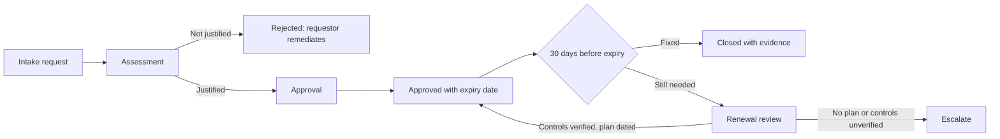

# Exception and risk acceptance procedure

Purpose: make sure every exception is assessed, approved by the right person, time-boxed, and either fixed or consciously renewed.

## Steps

1. **Intake.** Requestor states the issue, the system, why it cannot be fixed now, and what they propose as compensating controls.
2. **Assessment.** Score likelihood and impact (1-5 each). Check existing and compensating controls. Write the risk in one sentence: cause, event, consequence.
3. **Approval.** High risks go to the CISO or a delegated director. Medium risks go to the owning director. Low risks go to the system owner. Nobody approves an exception on their own system without a second reviewer.
4. **Expiry.** Every approval has an end date. The default is 6 months, and 12 months at most for Low risks.
5. **Early outreach.** At 30 days before expiry, contact the owner. They choose: remediate, close, or request a renewal.
6. **Renewal review.** Before recommending renewal, verify that the compensating controls still work (evidence, not assurance) and that there is a dated remediation plan. No plan means escalation.
7. **Closure.** Attach evidence that the fix is in place, then close the record and update the linked risk.

## Rules of thumb

- An exception without an expiry date is a permanent acceptance. Treat it as a defect.
- "We are working on it" is not a plan. A plan has an owner and a date.
- Expired and still in use means the risk is now unowned. Escalate it the same day.

## Template: 30-day expiry email

> Subject: Action needed: exception EXC-004 expires on [date]
>
> Hi [name],
>
> The exception for [system] (EXC-004) expires in 30 days. Could you let me know by [date] which of these applies?
> 1. The issue is fixed (please send evidence).
> 2. It is no longer needed (we will close it).
> 3. You need a renewal. In that case I need the remediation date and confirmation that [compensating controls] are still in place.
>
> Happy to jump on a short call if that is easier.
>
> Thanks,
> [your name]
